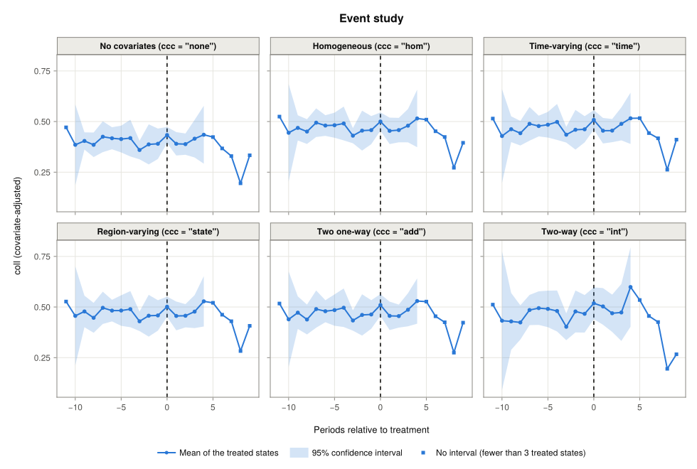
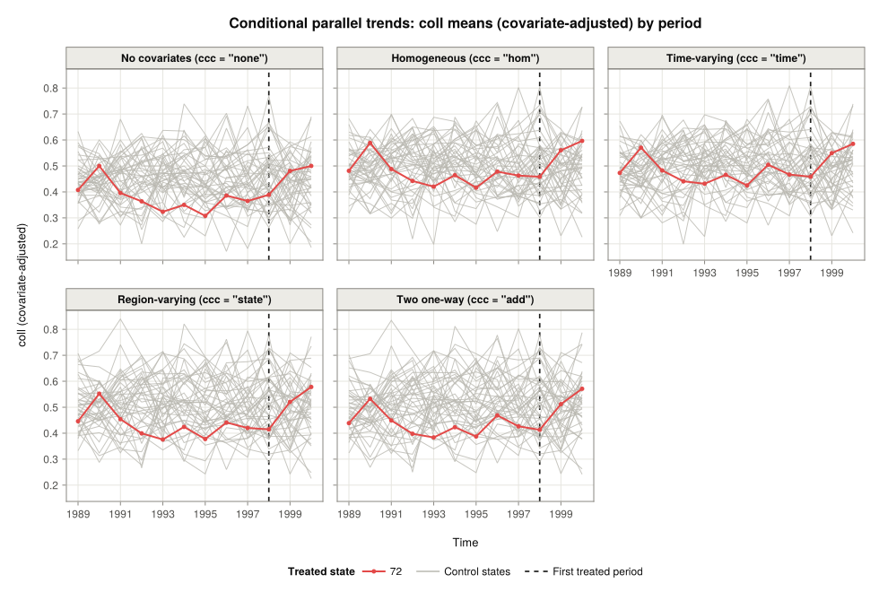
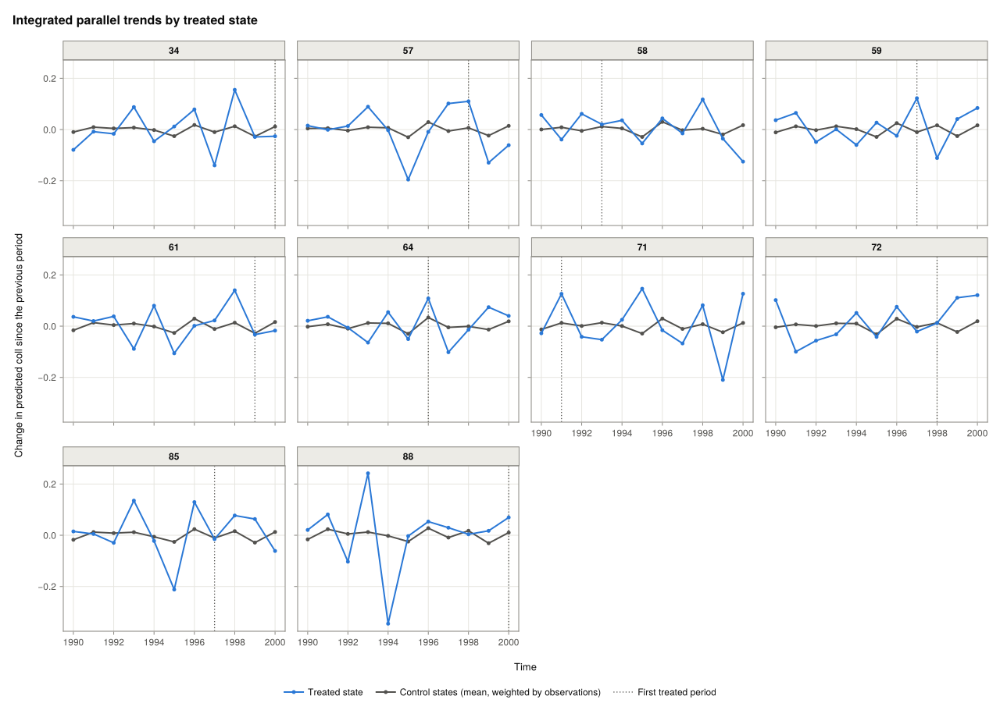

# DiDInt.jl

[](https://github.com/ebjamieson97/DiDInt.jl/actions/workflows/CI.yml)
[](https://codecov.io/gh/ebjamieson97/DiDInt.jl)
[](https://ebjamieson97.github.io/DiDInt.jl/stable)

Integrated difference-in-differences!

**DiDInt.jl** introduces two functions:
- `didint()`, which is used for estimating the average effect of treatment on the treated (ATT) while accounting for various violations of the common causal covariates (CCC) assumption
- `didint_plot()`, which prepares and draws parallel trends plots that help determine which CCC violation should be accounted for when using `didint()`, as well as event study plots. The plots are drawn with [Makie](https://docs.makie.org); the data behind them are returned as well, for use with any other plotting package.

To learn more about the common causal covariates assumption and integrated difference-in-differences please see [Karim & Webb (2025)](https://arxiv.org/abs/2412.14447).

A Stata wrapper for this package is available here: **[didintjl](https://github.com/ebjamieson97/didintjl)**.

An R wrapper for this package is available here: **[didintrjl](https://github.com/ebjamieson97/didintrjl)**.

See more detailed documentation on the [documentation page](https://ebjamieson97.github.io/DiDInt.jl/). Changes between versions are listed in the [changelog](CHANGELOG.md).

## Installation 
```
using Pkg
Pkg.add("DiDInt")
```

## `didint()` - Estimate ATT

The function `didint()` estimates the ATT while adjusting for covariates that may vary by state, time, or both. It works for both staggered and common adoption, and reports heteroskedasticity-robust and jackknife standard errors along with randomization inference p-values.

```julia
using DiDInt
using CSV, DataFrames # To read in data

# Define treated states and their respective treatment times
treated_states = ["34", "57", "58", "59", "61", "64", "71", "72", "85", "88"]
treated_times = [2000, 1998, 1993, 1997, 1999, 1996, 1991, 1998, 1997, 2000]

# Load data (test/data/merit.csv in this repository)
test_data = CSV.read("merit.csv", DataFrame)
test_data.state = string.(test_data.state)

# Run DID-INT model
result = didint("coll", "state", "year", test_data,
                treatment_times = treated_times,
                treated_states = treated_states,
                seed = 1234, ccc = "state",
                covariates = [:male, :asian, :black],
                agg = "cohort", nperm = 399)

# DID-INT results
#   Outcome:          coll
#   Model:            Region-Varying DID-INT (ccc = "state")
#   Covariates:       male, asian, black
#   Aggregation:      "cohort" (by treatment time)
#   Weighting:        "both"
#   Controls:         never-treated states
#   Periods:          1 year, from 1989 to 2000
#   Standard errors:  HC1 (se) and jackknife (jknife_se)
#   Permutations:     399 (seed 1234)
#
# Aggregate ATT
#  estimate       att        se          pval         jknife_se  jknife_pval  ri_pval
# ────────────────────────────────────────────────────────────────────────────────────
#  Aggregate ATT  0.0462414  0.00769881  0.000959237  0.0123516   0.00046902   0.0975
#
# Sub-aggregate ATTs by treatment time (7)
#  treatment_time  att          se          pval       jknife_se        jknife_pval      ri_pval  weight
# ──────────────────────────────────────────────────────────────────────────────────────────────────────────
#  1991-01-01       0.0553354   0.0222024   0.0342914  missing          missing           0.4575  0.201796
#  1993-01-01       0.0504489   0.0161905   0.0169391  missing          missing           0.5175  0.191535
#  1996-01-01       0.0424116   0.0255707   0.172536   missing          missing           0.5725  0.0756734
#  1997-01-01       0.0606879   0.0236147   0.037012         0.0328756        0.0708186   0.28    0.321077
#  1998-01-01       0.0398137   0.0406649   0.372511         0.0813398        0.626647    0.5825  0.108593
#  1999-01-01       0.00173622  0.00350574  0.707256   missing          missing           0.985   0.0354853
#  2000-01-01      -0.0253317   0.0333203   0.586179         0.0971445        0.795346    0.755   0.0658401

# The estimates are stored as tables...
result.agg          # the aggregate ATT with its standard errors and p-values
result.sub          # the sub-aggregate ATTs
result.att_st       # the ATT of each treated state in each period

# ...are available as vectors...
coef(result)                    # [0.0462414]
stderror(result)                # [0.00769881]
coef(result; level = :sub)      # the seven cohort ATTs

# ...and can be collected in one wide table
DataFrame(result)
```

`didint()` returns a `DiDIntResult`, which prints the summary shown above.

Other aggregations are available through the `agg` argument (`"cohort"`, `"simple"`, `"state"`, `"sgt"`, `"time"`, `"calendar"`), as are separate ATTs by policy when treated states adopt different policies (`"policy"`, `"policy_gt"`, `"policy_cohort"`, `"policy_calendar"`, `"policy_time"`). See the [documentation page](https://ebjamieson97.github.io/DiDInt.jl/) for details.

## `didint_plot()` - Parallel Trends and Event Study Plots

The `didint_plot()` function prepares the data for parallel trends plots and event study plots. It returns a `DiDIntPlot`, which holds a table for each kind of plot and can be drawn with `plot` (see [Plots](#plots) below).

```julia

# Prepare the data for every kind of plot
plot_data = didint_plot("coll", "state", "year", test_data,
                        treatment_times = treated_times,
                        treated_states = treated_states,
                        covariates = ["asian", "black", "male"])

# DID-INT plot data
#   Outcome:          coll
#   Covariates:       asian, black, male
#   ccc options:      none, hom, time, state, add, int
#   Treated states:   34 (2000), 57 (1998), 58 (1993), 59 (1997), 61 (1999), 64 (1996),
#                     71 (1991), 72 (1998), 85 (1997), 88 (2000)
#   Controls:         never-treated states
#   Periods:          1 year, from 1989 to 2000
#
# Tables of plot data, each drawn with plot(x; plot_type = ...) (see ?DiDIntPlot)
#   event          126 rows: ccc, time_since_treatment, y, se, ci_lower, ci_upper, ngroup
#   conditional    3060 rows: state, time, period, ccc, lambda, n
#   conditional2   23100 rows: state, time, period, ccc, delta, n, treated_state, base_period, treat_period
#   integrated     4620 rows: state, time, period, delta, n, treated_state_covars, treat_period
#   integrated2    4620 rows: state, time, period, delta, n, treated_state_covars, base_period, treat_period

# Conditional parallel trends: the covariate-adjusted mean outcome (lambda) of every state
# and period, for every ccc option except "int"
plot_data.conditional[1:4, :]
# 4×6 DataFrame
#  Row │ state   time    period  ccc     lambda    n
#      │ String  String  Int64   String  Float64   Int64
# ─────┼─────────────────────────────────────────────────
#    1 │ 11      1989         0  hom     0.467895     39
#    2 │ 11      1990         1  hom     0.316912     35
#    3 │ 11      1991         2  hom     0.445936     33
#    4 │ 11      1992         3  hom     0.579997     32

# Integrated parallel trends (ccc = "int"): for each treated state (treated_state_covars), the
# change since the previous period in the predicted outcome (delta) of that state and of its
# control states, all evaluated at that treated state's covariate means
plot_data.integrated[1:4, :]
# 4×7 DataFrame
#  Row │ state   time    period  delta       n      treated_state_covars  treat_period
#      │ String  String  Int64   Float64     Int64  String                Int64
# ─────┼───────────────────────────────────────────────────────────────────────────────
#    1 │ 34      1990         1  -0.0791523    375  34                              11
#    2 │ 11      1990         1  -0.125941      74  34                              11
#    3 │ 12      1990         1   0.0223095     72  34                              11
#    4 │ 13      1990         1  -0.160495      64  34                              11

# Event study: the mean of the treated states by period relative to treatment
plot_data.event[1:4, :]
# 4×7 DataFrame
#  Row │ ccc     time_since_treatment  y         se         ci_lower   ci_upper  ngroup
#      │ String  Int64                 Float64   Float64?   Float64?   Float64?  Int64
# ─────┼────────────────────────────────────────────────────────────────────────────────
#    1 │ add                      -11  0.51728   0.104552   -0.81118   1.84574        2
#    2 │ add                      -10  0.439195  0.0549642   0.202703  0.675687       3
#    3 │ add                       -9  0.472126  0.0289763   0.391675  0.552577       5
#    4 │ add                       -8  0.4383    0.030128    0.364579  0.51202        7
```

The `conditional2` and `integrated2` tables hold the same comparisons as changes since the period before each treated state's treatment. The `plot_type` argument of `didint_plot()` selects the kinds of plot data to prepare, for example `plot_type = ["event", "integrated2"]`.

## Plots

`plot` draws a `DiDIntPlot` once a [Makie](https://docs.makie.org) backend, such as CairoMakie, is loaded. Its `plot_type` argument chooses the plot, and it returns a Makie `Figure`.

```julia
using CairoMakie

# Event study: the mean of the treated states by period relative to treatment
plot(plot_data; plot_type = "event")
```



```julia
# Conditional parallel trends under each ccc option, here for treated state 72
plot(plot_data; treated_states = "72")
```



```julia
# Integrated parallel trends (ccc = "int"): each treated state next to the average of its control states
plot(plot_data; plot_type = "integrated")
```



There are more options: selecting treated states and `ccc` options, one panel per treated state, each control state instead of their average, equal weights, not-yet-treated states as controls, and versions of the parallel trends plots as changes since the pre-treatment period (`plot_type = "conditional2"` and `"integrated2"`), from which the ATT estimates and placebo estimates before treatment can be read. They are shown on the [Plotting Examples](https://ebjamieson97.github.io/DiDInt.jl/stable/plotting/) page of the documentation.

## Citations
- Karim & Webb (2025). ["Good Controls Gone Bad: Difference-in-Differences with Covariates".](https://arxiv.org/abs/2412.14447)
- MacKinnon & Webb (2020). ["Randomization inference for difference-in-differences with few treated clusters".](https://doi.org/10.1016/j.jeconom.2020.04.024)
